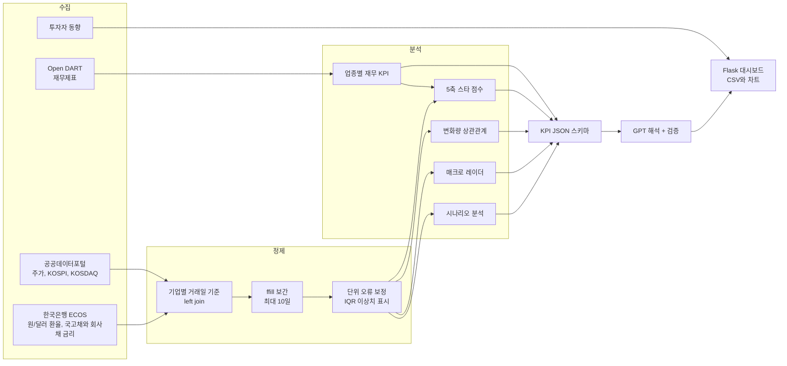

# 📈 FINANCIAL LAB

[](https://github.com/David9733/financial_analysis/actions/workflows/tests.yml)

기업명만 입력하면 재무제표, 주가, 환율과 금리를 거래일 기준으로 묶어 분석하는 기업 재무 및 매크로 분석 서비스

> **문제** 재무제표만으로는 환율과 금리가 움직일 때 이 기업 주가가 시장보다 더 흔들렸는지 알 수 없고, 4개 출처 데이터를 직접 맞추기 번거롭습니다.<br>
> **해결** 데이터를 거래일 기준으로 병합하고, 업종별 KPI, 시장 효과를 뺀 매크로 레이더와 금리 상승·원화 약세 시나리오를 자동 계산합니다.<br>
> **신뢰성** 계산할 수 없는 값은 추정하지 않고 사유를 표시하며, GPT 문장은 근거 KPI와 숫자를 Python으로 검증합니다. 테스트 203개.

---

## 📋 프로젝트 개요

| 항목 | 내용 |
|------|------|
| **개발 기간** | 2026.10 |
| **프로젝트 유형** | 개인 프로젝트 |
| **핵심 기술** | Python, Pandas, Matplotlib, Flask, Pydantic, OpenAI API |
| **데이터 출처** | [Open DART](https://opendart.fss.or.kr/)(재무제표), [공공데이터포털](https://www.data.go.kr/)(주가, KOSPI, KOSDAQ), [한국은행 ECOS](https://ecos.bok.or.kr/api/)(환율, 국고채와 회사채 금리), 네이버 증권 비공식 응답(투자자 동향) |
| **배포 링크** | [바로가기](https://financial-analysis-2026.vercel.app/) |

이 프로젝트는 다음 세 질문에 답합니다.

| 분석 질문 | 사용한 분석 |
|---|---|
| 평소 이 기업 주가는 환율, 금리, 신용 스프레드와 같은 방향으로 움직였는가? | 일별 변화량 Pearson 상관관계 |
| 그 움직임은 시장 전체 효과인가, 이 기업만의 특성인가? | 시장 상관을 뺀 **매크로 레이더**와 이동상관 안정성 |
| 금리 상승과 원화 약세가 함께 온 날, 기업은 시장보다 버텼는가? | 조건부 **시나리오 분석** |

## 🎬 시연

1개 기업 분석
오타 시 막음
기업명 : 삼성전자, 재무제표 조회기간: 3년, 주가 조회 기간: 1년


2개 이상 기업 분석
기업명 : 삼성전자, SK하이닉스, 현대차 재무제표 조회기간: 3년, 주가 조회 기간: 1년


결과 화면은 재무(KPI와 3년 추세 배지), 주가(이동평균, 볼린저 밴드, 투자자 비중), 매크로(레이더, 시나리오, 상관 차트), 요약(5축 스타차트, GPT 분석, CSV 다운로드) 탭으로 구성됩니다.

## 🛠️ 기술 스택 및 선택 이유

| 기술 | 버전 | 선택 이유 |
|------|------|-----------|
| **Python** | 3.10+ | API 수집, 분석과 웹 서버를 한 언어로 구성<br>표준 `urllib`로 공공 API 3개와 비공식 공개 응답 1개를 호출해 별도 HTTP 의존성 없이 운영 |
| **Pandas** | 2.3.3 | `merge_asof`로 거래일 기준 병합 시 직전 관측값만 사용해 미래 값 혼입 방지<br>`groupby`와 `shift`로 기업별 연속 연도 성장률과 평균자본 계산, `rolling().corr()`로 이동상관 계산 |
| **NumPy** | 2.2.6 | `np.select`로 기업별 업종(일반, 금융, 보험)을 벡터 연산으로 판별<br>`np.polyfit`으로 환율 변화율과 금리 변화폭 산점도의 추세선 기울기 계산 |
| **Matplotlib** | 3.10.9 | 서버에서 Agg 백엔드로 PNG 차트를 생성해 CSV와 함께 파일로 제공<br>koreanize-matplotlib 0.1.1로 배포 환경의 한글 폰트 깨짐 방지 |
| **Flask** | 3.1.3 | 분석 파이프라인을 그대로 호출하는 가벼운 웹 서버<br>진행률 조회와 백그라운드 GPT 분석 상태 조회 엔드포인트 구성 |
| **Pydantic** | 2.13.5 | GPT 응답 스키마를 정의해 섹션별 문장과 근거 KPI 키를 구조화 출력으로 강제<br>스키마를 벗어난 응답은 파싱 단계에서 차단 |
| **OpenAI API** | 2.54.0 | Responses API로 Python이 계산한 KPI JSON만 해석<br>`store=False`로 응답 저장 비활성화, 실패 시 KPI 기반 대체 인사이트로 전환 |
| **Pillow** | 12.3.0 | 서버리스 환경에서 차트를 WebP로 압축해 HTML에 직접 삽입<br>임시 파일이 사라져도 결과 화면의 차트 유지 |
| **Vercel** | - | Flask 앱을 서버리스 함수로 배포해 별도 서버 운영 없이 공개<br>`maxDuration` 300초 설정으로 다중 기업 분석처럼 오래 걸리는 요청 처리, 국내 API와 가까운 서울(`icn1`) 리전에서 실행 |


## ✨ 핵심 성과

- **4개 출처 데이터 통합**: Open DART, 공공데이터포털(주가와 지수), 한국은행 ECOS(환율과 금리) 및 투자자 동향 데이터를 거래일 기준 하나의 테이블로 병합
- **업종별 KPI 설계**: 일반기업, 금융업, 보험업의 계정 구조 차이를 반영해 KPI를 따로 계산하고, 계산할 수 없는 값은 추정하지 않고 사유를 기록
- **고정 기준 5축 스타 점수**: 성장성, 수익성, 재무 안정성, 효율성과 시장흐름을 최신 KPI와 최근 3개년 추세로 0점에서 100점까지 요약
- **데이터 품질 관리**: 결측 보간, 소수점 및 단위 오류 보정과 IQR 이상치 표시 내역을 `data_quality_log.csv`로 추적
- **검증된 LLM 해석**: GPT가 쓴 문장의 근거 KPI, 숫자와 금지 표현을 Python으로 검증하고 실패 시 KPI 기반 대체 인사이트 제공
- **재현 가능성**: 외부 API를 가짜 응답으로 대체한 테스트 203개를 GitHub Actions에서 자동 실행, 고정 버전 `requirements.lock`

## 🔄 분석 파이프라인



## 🔬 분석 설계와 의사결정

### 1. 수준값이 아닌 일별 변화량으로 상관을 계산

환율과 금리처럼 추세가 있는 시계열은 서로 관계가 없어도 수준값 상관이 높게 나옵니다. 이런 가짜 상관을 피하기 위해 분석에는 변화량을 사용합니다.

```text
주가와 시장지수  = 일간 수익률(%)
원/달러 환율     = 일간 변화율(%)
금리             = 일간 변화폭(bp)
신용 스프레드    = 일간 변화폭(bp)   # 회사채 3년 AA- − 국고채 3년
```

금리는 이미 백분율이므로 변화율이 아닌 변화폭(bp)을 사용합니다. 유효 관측값이 10개 이상일 때만 상관을 계산하며, `|r| < 0.3` 약함, `0.3 ≤ |r| < 0.7` 중간, `|r| ≥ 0.7` 강함으로 해석합니다.

### 2. 시장 효과를 분리하는 매크로 레이더

대부분의 종목은 시장지수와 함께 움직이므로, 기업-환율 상관이 높아도 시장 전체의 성질일 수 있습니다. 소속 시장지수(KOSPI 또는 KOSDAQ)의 상관을 빼서 기업 고유의 노출만 남깁니다.

```text
시장 대비 차이 = corr(기업 수익률, 외부 요인 변화) − corr(소속 시장지수 수익률, 외부 요인 변화)
```

시장 대비 차이 절댓값이 `0.15` 미만이면 노출 약, `0.30` 이상이면 강으로 보고, 이동상관 부호 유지율 80% 이상과 전환율 5% 이하를 안정으로 판정합니다. 이동상관 창과 중립 구간은 [분석 방법론](docs/analysis-methodology.md#6-매크로-레이더)에 정리했습니다.

### 3. 평균이 아닌 특정 환경의 실제 성과를 보는 시나리오 분석

상관은 평균적인 관계일 뿐이므로, 원/달러 환율 `+0.3%` 이상 **그리고** 국고채 3년 `+3bp` 이상인 거래일만 골라 기업과 시장의 평균 수익률을 비교합니다.

```text
시장 대비 평균 차이 = 기업 평균 수익률 − 소속 시장지수 평균 수익률
```

조건을 만족한 날이 없어도 결과를 억지로 만들려고 **기준을 낮추지 않습니다**. 해당 거래일 `0일`만 표시하고 수익률과 판정은 비워 두며, 표본이 10일 미만이면 `표본 매우 적음` 또는 `제한적 표본`으로 함께 표시합니다.

### 4. 업종별 KPI와 계산할 수 없는 값의 처리

| 구분 | 대표 KPI |
|---|---|
| 일반기업 | 매출 성장률, 영업이익률, ROE, 부채비율 |
| 금융업 | 순이자손익, 순수수료손익, ROE, ROA |
| 보험업 | 보험서비스수익 성장률, 보험서비스마진, ROE, 투자손익 |

은행과 보험사에는 일반적인 의미의 매출이 없어 일반기업 KPI를 그대로 적용하면 왜곡되므로, DART 계정 ID로 업종을 판별해 KPI 세트를 바꿉니다. 부호가 뒤집히는 값도 숫자로 내지 않습니다. 전년이 적자인 성장률은 `흑자전환` 또는 `적자지속`, 자본이 0 이하인 부채비율과 ROE는 `자본잠식`으로 표시합니다. 3년 추세 배지와 스타차트 기준은 [분석 방법론](docs/analysis-methodology.md)에 정리했습니다.

## 🧹 데이터 품질 관리

| 문제 | 처리 |
|---|---|
| 휴장일이나 미고시로 외부 요인 값이 없는 거래일 | 직전 값으로 채움(ffill), 10일 넘는 공백은 결측 유지 |
| 보간된 날의 변화량 0 | 상관이 왜곡되지 않도록 **상관 계산과 이상치 판정에서 제외** |
| 앞뒤 값 대비 10배, 100배, 1000배 튀었다 복귀하는 값 | 소수점이나 단위 오류로 보고 보정, 같은 날 시가, 고가, 저가도 함께 보정 |
| 하루 변화량이 IQR 범위 밖 | 삭제하지 않고 `원인 확인 필요`로만 표시 (실제 사건일 수 있음) |

모든 처리는 원래 값, 처리 값과 사유와 함께 `data_quality_log.csv`에 기록됩니다.

## 🤖 LLM 활용 방식

GPT는 데이터를 새로 계산하거나 수집하지 않고, **Python과 Pandas가 계산한 KPI JSON만 해석**합니다.

1. 구조화 출력(Pydantic 스키마)으로 성장성, 수익성, 안정성, 시장, 시나리오 섹션별 문장과 근거 KPI 키를 받습니다.
2. 근거 키가 실제 KPI에 있는지, 문장 속 숫자가 입력값과 일치하는지, 투자 권유 표현이 없는지 검증합니다.
3. 검증에 실패한 문장은 KPI 기반 문장으로 교체하고, API 오류가 나면 KPI 기반 대체 인사이트를 표시합니다.
4. 화면에서는 GPT가 쓴 숫자 대신 **근거 키에 해당하는 실제 KPI 값**을 Python이 채워 넣습니다.

웹 화면은 재무, 주가와 매크로 결과를 먼저 보여 주고 GPT 분석은 백그라운드에서 생성합니다. 공개 사이트에서는 서버가 서명한 15분 유효 요청만 GPT를 호출해 임의 요청으로 비용이 생기지 않게 했고, 응답 저장은 `store=False`로 비활성화했습니다.

## 🔧 트러블슈팅

| 문제 | 원인 | 해결 |
|---|---|---|
| 여러 기업을 함께 계산하면 수집하지 않은 기업과 연도 행이 생김 | `pivot_table`이 모든 기업과 연도 조합을 만들어 존재하지 않는 연도까지 행으로 채움 | 실제로 수집된 기업과 연도 조합에 다시 결합해 가짜 연도 행 제거 |
| 금융사와 보험사의 최근 3년 추세가 계산되지 않음 | DART가 일부 금융과 보험사의 과거 사업연도를 단독 응답으로 제공하지 않음 | 최신 사업보고서에 포함된 전기와 전전기 비교금액으로 빠진 연도와 계정만 복원하고, 직접 조회한 값을 우선 사용 |
| 1개월 조회에서 최근 거래량 변화율, 20일 이동평균 대비와 볼린저밴드 위치가 계산 불가 | 거래량 변화율은 40거래일, 이동평균과 볼린저밴드는 20거래일이 필요한데 1개월은 약 20거래일이고 공휴일이 끼면 더 적음 | 계산용으로만 70일 전부터 시세를 추가 수집하고, 화면과 다른 지표는 선택 기간을 그대로 사용 |
| Vercel 배포 후 GPT 분석 상태와 차트 파일을 찾지 못함 | 서버리스 인스턴스는 메모리와 임시 파일을 요청 사이에 공유하지 않음 | 차트는 HTML에 직접 삽입(2.2MB 초과 시 WebP로 압축)하고, GPT 분석은 압축한 KPI를 브라우저가 다시 보내는 무상태 방식으로 변경 |
| 배포 사이트의 재무 수집 단계가 로컬(약 1초)보다 훨씬 오래 걸림 | Vercel 함수가 기본 리전인 미국 워싱턴(`iad1`)에서 실행되어 DART, 공공데이터포털, ECOS를 호출할 때마다 태평양을 왕복. 응답 헤더 `x-vercel-id: icn1::iad1`로 접속 지점(서울)과 실행 지점(미국)이 다른 것을 확인 | `vercel.json`에 `"regions": ["icn1"]`을 지정해 함수를 서울에서 실행(`icn1::icn1` 확인) |
| 장기간 환율을 날짜별로 요청하면 호출 횟수와 대기시간이 커짐 | 날짜 하나당 API를 한 번씩 호출 | 한국은행 ECOS 기간 조회로 최대 1,000행씩 수집하고, 1,000행을 넘을 때만 다음 페이지를 요청 |
| 기업명 오타나 합병 전후의 비슷한 법인명 때문에 다른 기업이 선택될 수 있음 | 유사도만으로 자동 선택하면 이름이 비슷한 별도 법인이 뽑힘 | 정확한 이름과 명확한 부분 일치만 자동 선택하고, 오타는 최대 5개 후보를 안내해 사용자가 정확한 이름을 다시 입력하도록 처리 |
| 투자자 동향 조회가 실패할 수 있음 | 공식 API가 없어 비공식 공개 응답의 형식이 바뀌면 해석 불가 | 별도 예외로 분리해 실패해도 나머지 분석은 계속 진행하고 경고만 표시 |

API 키 누락, 서비스 미승인과 호출 한도 오류의 조치는 [기술 및 운영 가이드의 문제 해결](docs/technical-guide.md#8-문제-해결)에서 확인할 수 있습니다.

## 🚀 빠른 시작

```bash
git clone https://github.com/David9733/financial_analysis.git
cd financial_analysis
cp .env.example .env        # Windows PowerShell: Copy-Item .env.example .env
```

`.env`에 `DART_KEY`(필수)를 입력합니다. 공공데이터포털, ECOS와 OpenAI 키는 선택이며, 없으면 해당 데이터만 제외하고 분석을 계속합니다. 키별 발급처와 선택 설정은 [기술 및 운영 가이드](docs/technical-guide.md#1-api-키)를 참고하세요.

```bash
uv run --python 3.10 --isolated --with-requirements requirements.lock src/app.py   # 웹 앱 (http://127.0.0.1:5000)
python -m unittest discover -s tests                                                # 테스트 (API 키 불필요)
```

`uv` 없이 설치하는 방법과 CLI 사용법은 [기술 및 운영 가이드](docs/technical-guide.md#2-실행)에 있습니다.

## ⚠️ 한계와 향후 개선

**해석 시 한계**

- 상관관계는 인과관계가 아니며, 매크로 레이더는 실제 영업 노출액이나 미래 주가를 의미하지 않습니다.
- 업종지수를 사용하지 않아 시장 효과와 업종 효과를 완전히 분리하지 못합니다.
- 신용 스프레드는 시장 전체 지표이며 개별 기업의 실제 조달금리가 아닙니다.
- 짧은 조회기간은 관측 수가 적어 일부 날짜에 민감합니다.
- 상관계수, 시장 대비 차이와 시나리오 수익률 차이에 유의성 검정이나 신뢰구간을 적용하지 않아 작은 차이는 우연일 수 있습니다.
- 노출 강도(0.15, 0.30)와 안정성(80%, 5%) 같은 판정 기준값은 통계적으로 도출한 값이 아니라 경험적 기준입니다. 설정 이유는 [분석 방법론](docs/analysis-methodology.md#8-판정-기준값을-정한-방식)에 정리했습니다.
- 스타 점수는 현재 KPI를 고정 기준으로 요약한 참고값이며 투자등급, 기업가치 평가나 미래 주가 예측이 아닙니다.
- 결과는 공개 데이터 탐색용이며 투자, 매수 또는 매도 권고가 아닙니다.

**향후 개선**

- 업종지수를 추가해 시장, 업종과 기업 고유 효과를 단계적으로 분리
- 상관 차이 대신 다중 회귀 기반 베타로 외부 요인 민감도 추정
- 상관계수와 시나리오 수익률 차이에 부트스트랩 신뢰구간 적용
- 공개 배포 사이트에 요청 제한과 사용자 인증 추가

## 📚 문서

- [분석 방법론](docs/analysis-methodology.md): 지표 계산식, 3년 추세와 스타 점수 기준, 결측 처리, 이상치와 상관분석 기준
- [기술 및 운영 가이드](docs/technical-guide.md): API 키와 실행, Vercel 배포, 출력 구조, 소스 구조, 문제 해결과 보안
