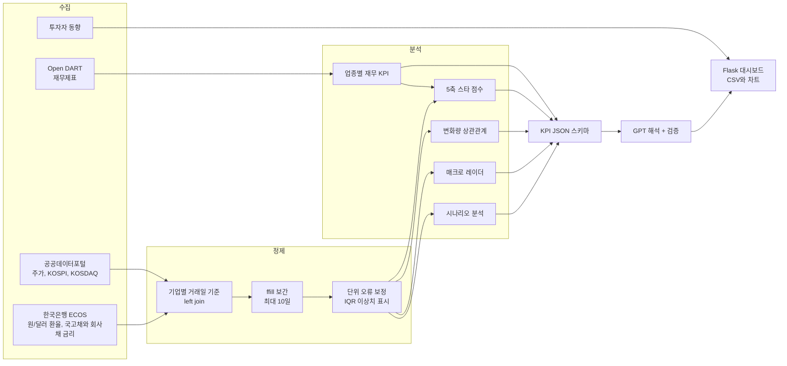

# 📈 FINANCIAL LAB

기업명만 입력하면 재무제표, 주가, 환율과 금리를 거래일 기준으로 묶어 분석하는 기업 재무 및 매크로 분석 서비스

**목차**: [개요](#-프로젝트-개요) | [목적](#-프로젝트-목적) | [기술 스택](#️-기술-스택-및-선택-이유) | [핵심 성과](#-핵심-성과) | [파이프라인](#-분석-파이프라인) | [분석 설계](#-분석-설계와-의사결정) | [데이터 품질](#-데이터-품질-관리) | [LLM 활용](#-llm-활용-방식) | [트러블슈팅](#-트러블슈팅) | [빠른 시작](#-빠른-시작) | [사용 방법](#-사용-방법) | [한계](#️-한계와-향후-개선)
---

## 📋 프로젝트 개요

| 항목 | 내용 |
|------|------|
| **개발 기간** | 2026.10 |
| **프로젝트 유형** | 개인 프로젝트 |
| **핵심 기술** | Python, Pandas, Matplotlib, Flask, Pydantic, OpenAI API |
| **데이터 출처** | Open DART, 공공데이터포털(금융위원회), 한국은행 ECOS, 투자자 동향 |
| **배포 링크** | [바로가기](https://financial-analysis-2026.vercel.app/) |

---

## 🎯 프로젝트 목적

"재무제표 밖의 움직임까지, 한 화면에서 본다."

재무제표로는 기업이 얼마나 벌었는지 알 수 있지만, 환율이 오르거나 금리가 뛸 때 이 기업 주가가 시장보다 더 흔들렸는지는 알 수 없습니다.<br>
이를 확인하려면 DART, 주가, 환율과 금리 데이터를 각각 내려받아 날짜를 맞추고 휴장일, 결측과 단위 오류를 직접 처리해야 합니다.<br>
이 프로젝트는 4개 출처의 데이터를 거래일 기준으로 통합하고 업종별 KPI, 상관관계와 시나리오 분석까지 자동화합니다.

| 구분 | 내용 |
|------|------|
| **기존 방식** | DART 재무제표, 주가, 환율과 금리를 사이트별로 내려받아 날짜를 맞추고 결측과 단위 오류를 직접 정리 |
| **본 서비스** | 기업명과 조회기간만 입력하면 데이터를 거래일 기준으로 병합하고 업종별 KPI, 매크로 레이더와 시나리오 분석을 자동 계산 |
| **효과** | 반복적인 수집과 정제 없이 재무 성과와 외부 요인 반응을 한 화면에서 비교하고, 모든 처리 내역은 품질 로그로 추적 |

이 프로젝트는 다음 세 질문에 답합니다.

| 분석 질문 | 사용한 분석 |
|---|---|
| 평소 이 기업 주가는 환율, 금리, 신용 스프레드와 같은 방향으로 움직였는가? | 일별 변화량 Pearson 상관관계 |
| 그 움직임은 시장 전체 효과인가, 이 기업만의 특성인가? | 시장 상관을 뺀 **매크로 레이더**와 이동상관 안정성 |
| 금리 상승과 원화 약세가 함께 온 날, 기업은 시장보다 버텼는가? | 조건부 **시나리오 분석** |

## 🎬 시연

https://github.com/user-attachments/assets/fd538833-aba5-4605-85de-0af79b1dd0b6

## 🛠️ 기술 스택 및 선택 이유

| 기술 | 버전 | 선택 이유 |
|------|------|-----------|
| **Python** | 3.10+ | API 수집, 분석과 웹 서버를 한 언어로 구성<br>표준 `urllib`로 4개 공공 API를 호출해 별도 HTTP 의존성 없이 운영 |
| **Pandas** | 2.3.3 | `merge_asof`로 거래일 기준 병합 시 직전 관측값만 사용해 미래 값 혼입 방지<br>`groupby`와 `shift`로 기업별 연속 연도 성장률과 평균자본 계산, `rolling().corr()`로 이동상관 계산 |
| **NumPy** | 2.2.6 | `np.select`로 기업별 업종(일반, 금융, 보험)을 벡터 연산으로 판별<br>`np.polyfit`으로 환율 변화율과 금리 변화폭 산점도의 추세선 기울기 계산 |
| **Matplotlib** | 3.10.9 | 서버에서 Agg 백엔드로 PNG 차트를 생성해 CSV와 함께 파일로 제공<br>koreanize-matplotlib 0.1.1로 배포 환경의 한글 폰트 깨짐 방지 |
| **Flask** | 3.1.3 | 분석 파이프라인을 그대로 호출하는 가벼운 웹 서버<br>진행률 조회와 백그라운드 GPT 분석 상태 조회 엔드포인트 구성 |
| **Pydantic** | 2.13.5 | GPT 응답 스키마를 정의해 섹션별 문장과 근거 KPI 키를 구조화 출력으로 강제<br>스키마를 벗어난 응답은 파싱 단계에서 차단 |
| **OpenAI API** | 2.54.0 | Responses API로 Python이 계산한 KPI JSON만 해석<br>`store=False`로 응답 저장 비활성화, 실패 시 KPI 기반 대체 인사이트로 전환 |
| **Pillow** | 12.3.0 | 서버리스 환경에서 차트를 WebP로 압축해 HTML에 직접 삽입<br>임시 파일이 사라져도 결과 화면의 차트 유지 |
| **Vercel** | - | Flask 앱을 서버리스 함수로 배포해 별도 서버 운영 없이 공개<br>`maxDuration` 300초 설정으로 다중 기업 분석처럼 오래 걸리는 요청 처리 |


## ✨ 핵심 성과

- **4개 출처 데이터 통합**: Open DART, 공공데이터포털(주가와 지수), 한국은행 ECOS(환율과 금리) 및 투자자 동향 데이터를 거래일 기준 하나의 테이블로 병합
- **업종별 KPI 설계**: 일반기업, 금융업, 보험업의 계정 구조 차이를 반영해 KPI를 따로 계산하고, 계산할 수 없는 값은 추정하지 않고 사유를 기록
- **고정 기준 5축 스타 점수**: 성장성, 수익성, 재무 안정성, 효율성과 시장흐름을 최신 KPI와 최근 3개년 추세로 0점에서 100점까지 요약
- **데이터 품질 관리**: 결측 보간, 소수점 및 단위 오류 보정과 IQR 이상치 표시 내역을 `data_quality_log.csv`로 추적
- **검증된 LLM 해석**: GPT가 쓴 문장의 근거 KPI, 숫자와 금지 표현을 Python으로 검증하고 실패 시 KPI 기반 대체 인사이트 제공
- **재현 가능성**: 외부 API를 가짜 응답으로 대체한 테스트 191개와 하위 테스트 18개, 고정 버전 `requirements.lock`

## 🔄 분석 파이프라인



## 🔬 분석 설계와 의사결정

### 1. 수준값이 아닌 일별 변화량으로 상관을 계산

환율과 금리처럼 추세가 있는 시계열은 서로 관계가 없어도 수준값 상관이 높게 나옵니다. 이런 가짜 상관을 피하기 위해 분석에는 변화량을 사용합니다.

```text
주가와 시장지수  = 일간 수익률(%)
원/달러 환율     = 일간 변화율(%)
금리             = 일간 변화폭(bp)
신용 스프레드    = 일간 변화폭(bp)   # 회사채 3년 AA- − 국고채 3년
```

금리는 이미 백분율이므로 변화율이 아닌 변화폭(bp)을 사용합니다. 유효 관측값이 10개 이상일 때만 상관을 계산하며, `|r| < 0.3` 약함, `0.3 ≤ |r| < 0.7` 중간, `|r| ≥ 0.7` 강함으로 해석합니다.

### 2. 시장 효과를 분리하는 매크로 레이더

대부분의 종목은 시장지수와 함께 움직이므로, 기업-환율 상관이 높아도 시장 전체의 성질일 수 있습니다. 소속 시장지수(KOSPI 또는 KOSDAQ)의 상관을 빼서 기업 고유의 노출만 남깁니다.

```text
시장 대비 차이 = corr(기업 수익률, 외부 요인 변화) − corr(소속 시장지수 수익률, 외부 요인 변화)
```

| 판정 | 기준 |
|---|---|
| 노출 약 / 중 / 강 | 시장 대비 차이 절댓값 `< 0.15` / `0.15 ~ 0.30` / `≥ 0.30` |
| 안정 | 이동상관 부호 유지율 80% 이상 및 부호 전환율 5% 이하 |

이동상관 창은 1개월 10일, 3개월 20일, 6개월 이상 60거래일입니다. 전체기간 상관이 `-0.1 ~ +0.1`이면 `방향성 없음`으로 표시하고, 1개월과 3개월 결과는 단기 참고값으로 구분합니다.

### 3. 평균이 아닌 특정 환경의 실제 성과를 보는 시나리오 분석

상관은 평균적인 관계일 뿐이므로, 원/달러 환율 `+0.3%` 이상 **그리고** 국고채 3년 `+3bp` 이상인 거래일만 골라 기업과 시장의 평균 수익률을 비교합니다.

```text
시장 대비 평균 차이 = 기업 평균 수익률 − 소속 시장지수 평균 수익률
```

조건을 만족한 날이 없어도 결과를 억지로 만들려고 **기준을 낮추지 않습니다**. 이때 화면에는 해당 거래일 `0일`만 표시하고 수익률과 판정은 `-`로 비워 둡니다. 표본이 1일에서 4일이면 `표본 매우 적음`, 5일에서 9일이면 `제한적 표본`으로 함께 표시합니다.

### 4. 업종별 KPI

| 구분 | 대표 KPI |
|---|---|
| 일반기업 | 매출 성장률, 영업이익률, ROE, 부채비율 |
| 금융업 | 순이자손익, 순수수료손익, ROE, ROA |
| 보험업 | 보험서비스수익 성장률, 보험서비스마진, ROE, 투자손익 |

은행과 보험사에는 일반적인 의미의 매출이 없어 일반기업 KPI를 그대로 적용하면 왜곡됩니다. 그래서 업종을 판별해 KPI 세트를 바꿉니다. 연결재무제표를 우선하고, 원천 계정이나 비교연도가 없으면 `비교연도 없음`처럼 사유를 남깁니다.

최근 3개 연속 사업연도의 개선, 악화, 보합과 변동을 판정하기 위해 화면 조회기간과 별도로 계산용 사업보고서를 최대 4개 확보합니다. 과거 연도의 단독 API 응답이 없으면 최신 사업보고서의 전기 및 전전기 비교금액으로 누락된 계정만 보완합니다.

스타차트는 일반기업, 금융업과 보험업에 서로 다른 재무지표를 적용하고 시장흐름에는 공통 기준을 사용합니다. 최신 KPI 80%와 최근 3개년 추세 20%를 반영하며, 함께 조회한 기업이 바뀌어도 점수가 변하지 않는 절대평가입니다. 금융업과 보험업의 자기자본비중, 흑자 지속성과 자산효율은 현재 수집 데이터로 만든 대체지표이며 공식 감독비율이 아닙니다.

상세 계산식은 [분석 방법론](docs/analysis-methodology.md)에 정리했습니다.

## 🧹 데이터 품질 관리

| 문제 | 처리 |
|---|---|
| 휴장일이나 미고시로 외부 요인 값이 없는 거래일 | 직전 값으로 채움(ffill), 첫 구간은 조회 시작 전 10일 자료 사용 |
| 10일 넘게 관측값이 없는 공백 | 오래된 값으로 채우지 않고 결측 유지 |
| 보간된 날의 변화량 0 | 상관이 왜곡되지 않도록 **상관 계산과 이상치 판정에서 제외** |
| 앞뒤 값 대비 10배, 100배, 1000배 튀었다 복귀하는 값 | 소수점이나 단위 오류로 보고 보정, 같은 날 시가, 고가, 저가도 함께 보정 |
| 하루 변화량이 IQR 범위 밖 | 삭제하지 않고 `원인 확인 필요`로만 표시 (실제 사건일 수 있음) |

모든 처리는 원래 값, 처리 값과 사유와 함께 `data_quality_log.csv`에 기록됩니다.

## 🤖 LLM 활용 방식

GPT는 데이터를 새로 계산하거나 수집하지 않고, **Python과 Pandas가 계산한 KPI JSON만 해석**합니다.

1. 구조화 출력(Pydantic 스키마)으로 성장성, 수익성, 안정성, 시장, 시나리오 섹션별 문장과 근거 KPI 키를 받습니다.
2. 근거 키가 실제 KPI에 있는지, 문장 속 숫자가 입력값과 일치하는지, 투자 권유 표현이 없는지 검증합니다.
3. 검증에 실패하면 실패 사유를 담아 다시 요청합니다(첫 요청 포함 최대 3번). API 오류가 나거나 끝내 검증을 통과하지 못하면 KPI 기반 대체 인사이트를 표시합니다.
4. 화면에서는 GPT가 쓴 숫자 대신 **근거 키에 해당하는 실제 KPI 값**을 Python이 채워 넣습니다.

웹 화면은 재무, 주가와 매크로 결과를 먼저 표시하고 GPT 분석을 별도 요청으로 처리합니다. GPT 요청은 기본 240초까지 처리하며, 검증에 실패한 문장은 다시 요청하지 않고 KPI 기반 문장으로 교체합니다. 최대 3번 요청은 CLI 실행에 적용됩니다.

응답 저장은 `store=False`로 비활성화하며, API 키가 없어도 재무 및 시장 분석은 모두 이용할 수 있습니다.

## 🔧 트러블슈팅

| 문제 | 원인 | 해결 |
|---|---|---|
| 여러 기업을 함께 계산하면 수집하지 않은 기업과 연도 행이 생김 | `pivot_table`이 모든 기업과 연도 조합을 만들어 존재하지 않는 연도까지 행으로 채움 | 실제로 수집된 기업과 연도 조합에 다시 결합해 가짜 연도 행 제거 |
| 금융사와 보험사의 최근 3년 추세가 계산되지 않음 | DART가 일부 금융과 보험사의 과거 사업연도를 단독 응답으로 제공하지 않음 | 최신 사업보고서에 포함된 전기와 전전기 비교금액으로 빠진 연도와 계정만 복원하고, 직접 조회한 값을 우선 사용 |
| 1개월 조회에서 최근 거래량 변화율, 20일 이동평균 대비와 볼린저밴드 위치가 계산 불가 | 거래량 변화율은 40거래일, 이동평균과 볼린저밴드는 20거래일이 필요한데 1개월은 약 20거래일이고 공휴일이 끼면 더 적음 | 계산용으로만 70일 전부터 시세를 추가 수집하고, 화면과 다른 지표는 선택 기간을 그대로 사용 |
| Vercel 배포 후 GPT 분석 상태와 차트 파일을 찾지 못함 | 서버리스 인스턴스는 메모리와 임시 파일을 요청 사이에 공유하지 않음 | 차트는 HTML에 직접 삽입(2.2MB 초과 시 WebP로 압축)하고, GPT 분석은 압축한 KPI를 브라우저가 다시 보내는 무상태 방식으로 변경 |
| 장기간 환율을 날짜별로 요청하면 호출 횟수와 대기시간이 커짐 | 날짜 하나당 API를 한 번씩 호출 | 한국은행 ECOS 기간 조회로 최대 1,000행씩 수집하고, 1,000행을 넘을 때만 다음 페이지를 요청 |
| 기업명 오타나 합병 전후의 비슷한 법인명 때문에 다른 기업이 선택될 수 있음 | 유사도만으로 자동 선택하면 이름이 비슷한 별도 법인이 뽑힘 | 정확한 이름과 명확한 부분 일치만 자동 선택하고, 오타는 최대 5개 후보를 안내해 사용자가 정확한 이름을 다시 입력하도록 처리 |
| 투자자 동향 조회가 실패할 수 있음 | 공식 API가 없어 비공식 공개 응답의 형식이 바뀌면 해석 불가 | 별도 예외로 분리해 실패해도 나머지 분석은 계속 진행하고 경고만 표시 |

API 키 누락, 기업명 검색 실패, 서비스 미승인 및 호출 한도 오류의 원인과 조치는 [기술 및 운영 가이드의 문제 해결](docs/technical-guide.md#8-문제-해결)에서 확인할 수 있습니다.

## 🖥️ 화면 구성

결과 화면 상단에는 KOSPI, KOSDAQ, 원/달러 환율과 금리의 최신값 및 기업 스냅샷을 표시합니다.

| 탭 | 내용 |
|---|---|
| 재무 | 전체 재무 KPI, 최근 3개년 추세 배지와 연도별 재무 차트, 두 기업 이상이 같은 연도에 값을 가진 지표의 비교 차트 |
| 주가 | 주가 KPI, 정규화 주가 비교, 이동평균, 볼린저 밴드, 거래량과 투자자 비중 |
| 매크로 | 시장 및 외부 요인, 매크로 레이더, 시나리오 분석과 상관관계 차트 |
| 요약 | 종합 인사이트, 5축 기업 스타차트, GPT 기업 분석, 데이터 미리보기와 CSV 다운로드 |

결과는 재무 탭부터 표시하고 GPT 기업 분석은 백그라운드에서 별도로 생성합니다. 브라우저는 완료 상태를 계속 확인하며, GPT가 실패하면 계산된 KPI 기반 분석으로 대체합니다.

다중 기업에서는 지표를 행, 기업을 열로 둔 비교표와 첫 공통 거래일을 100으로 맞춘 주가 비교 차트를 제공합니다. 재무 비교 차트는 업종이 달라도 같은 지표가 있고 같은 연도에 값이 있는 기업이 두 곳 이상이면 만들며, 값이 하나뿐인 막대그래프는 만들지 않습니다. 스타차트는 처음 두 기업을 켜고 기업명 버튼으로 원하는 기업을 표시하거나 숨길 수 있습니다.

입력 화면과 결과 화면 오른쪽 아래에는 사용법, 지표 의미와 오류 해결을 안내하는 챗봇(Chatling)이 있습니다. 챗봇은 분석 결과의 수치를 볼 수 없으므로 수치를 확인할 탭과 읽는 방법을 안내하며, 투자 권유는 하지 않습니다.

## 🗂️ 데이터 출처

| 영역 | 데이터 | 출처 |
|---|---|---|
| 재무 | 기업 정보와 연간 재무제표 | [Open DART](https://opendart.fss.or.kr/) |
| 주가 및 시장 | 일별 OHLC, 거래량, 시가총액, KOSPI와 KOSDAQ 종가 | [공공데이터포털](https://www.data.go.kr/) 금융위원회 |
| 환율 및 금리 | 원/달러 매매기준율, 국고채 3년과 회사채 3년 AA- | [한국은행 ECOS](https://ecos.bok.or.kr/api/) |
| 투자자 | 최근 거래일의 기관, 개인, 외국인과 기타 매수 및 매도 거래량 | 네이버 모바일 증권 비공식 공개 응답 |

## 🚀 빠른 시작

### 사전 요구사항

- Python 3.10 이상
- Open DART API 키
- 선택 기능을 사용할 경우 공공데이터포털, 한국은행 ECOS 및 OpenAI API 키

공공데이터포털에서는 금융위원회의 `주식시세정보`와 `지수시세정보`를 각각 활용 신청해야 합니다. 선택 API 키가 없거나 호출에 실패하면 해당 데이터만 제외하고 가능한 분석은 계속 실행합니다.

### 1. API 키 준비

```bash
git clone https://github.com/David9733/financial_analysis.git
cd financial_analysis
cp .env.example .env        # Windows PowerShell: Copy-Item .env.example .env
```

| 환경 변수 | 필수 여부 | 없을 때 |
|---|---|---|
| `DART_KEY` | **필수** | 분석 불가 |
| `PUBLIC_STOCK_API_KEY` | 선택 | 주가와 시장지수 분석 생략 |
| `ECOS_API_KEY` | 선택 | 환율, 금리와 신용 스프레드 지표 제외 |
| `OPENAI_API_KEY` | 선택 | KPI 기반 대체 인사이트 표시 |
| `OPENAI_MODEL` | 선택 | 기본값 `gpt-4o-mini` |
| `GPT_BACKGROUND_TIMEOUT_SECONDS` | 선택 | GPT 백그라운드 요청 제한 기본값 240초 적용 |

`DART_API_KEY`, `STOCK_API_KEY` 및 `GPT_KEY`도 각각 `DART_KEY`, `PUBLIC_STOCK_API_KEY` 및 `OPENAI_API_KEY`의 호환 이름으로 인식합니다. 시스템 환경 변수와 `.env`에 같은 키가 있으면 시스템 환경 변수를 우선합니다. API 키 발급처와 데이터별 상세 설정은 [기술 및 운영 가이드](docs/technical-guide.md#1-api-키)를 참고하세요.

### 2. 설치와 실행

```bash
python -m venv .venv
# Windows
.\.venv\Scripts\python.exe -m pip install -r requirements.lock
.\.venv\Scripts\python.exe src/app.py
# macOS / Linux
.venv/bin/python -m pip install -r requirements.lock
.venv/bin/python src/app.py
```

브라우저에서 `http://127.0.0.1:5000`을 엽니다. `uv`를 사용한다면 한 줄로 실행할 수 있습니다.

```bash
uv run --python 3.10 --isolated --with-requirements requirements.lock src/app.py
```

`requirements.txt`는 호환 가능한 버전 범위를, `requirements.lock`은 검증된 고정 버전을 담습니다. 재현 가능한 실행에는 `requirements.lock` 사용을 권장합니다.

### 3. 테스트

```bash
python -m unittest discover -s tests
```

테스트 191개와 하위 테스트 18개는 외부 API를 가짜 응답으로 대체하므로 네트워크와 API 키 없이 실행됩니다. `uv` 환경에서는 다음 명령으로 별도 가상환경 설정 없이 실행할 수 있습니다.

```bash
uv run --python 3.10 --isolated --with-requirements requirements.lock --with pytest -m pytest -q
```

## 🧭 사용 방법

### 웹 대시보드

1. 기업명을 1개에서 10개까지 입력합니다. 쉼표, 세미콜론 및 줄바꿈으로 구분할 수 있으며 중복 이름은 자동으로 제거됩니다.
2. 재무제표 조회기간은 최근 1년에서 10년, 주가 조회기간은 1개월, 3개월, 6개월, 1년 및 3년 중에서 선택합니다.
3. 한 기업은 상세 분석, 두 기업 이상은 동일한 기준의 비교 분석으로 표시됩니다.
4. 결과 화면의 재무, 주가, 매크로 및 요약 탭을 확인하고 필요한 CSV와 차트를 내려받습니다.

기업명은 정확히 일치하거나 하나의 법인으로 확정되는 부분 이름만 자동 선택합니다. 오타나 여러 법인과 일치하는 이름은 후보를 안내하며, 사용자가 정확한 기업명을 다시 입력해야 합니다.

### CLI

`src/main.py` 상단의 `COMPANIES`, `START_YEAR`, `END_YEAR` 및 `NUMBER_OF_YEARS`를 설정한 뒤 실행합니다.

```bash
python src/main.py
```

CLI의 기본 주가 조회기간은 1년이며 결과는 `output/cli/`에 저장됩니다. 코드에서 조회기간이나 GPT 실행 여부를 제어하려면 `run_integrated_analysis()`를 직접 사용할 수 있습니다. 자세한 예시는 [기술 및 운영 가이드](docs/technical-guide.md#cli)를 참고하세요.

## 📤 생성 결과

웹 결과는 `output/web_runs/<실행 ID>/`, CLI 결과는 `output/cli/`에 저장됩니다.

| 결과물 | 내용 |
|---|---|
| `financial_analysis.csv` | 업종별 연간 재무지표 |
| `stock_prices.csv`, `stock_summary.csv` | 일별 주가와 기간 요약 |
| `investor_summary.csv` | 투자자별 매수, 매도, 순매수 거래량과 비중 |
| `market_macro.csv` | 주가, 시장지수와 외부 요인의 수준값 및 변화량 |
| `data_quality_log.csv` | 보간, 단위 보정과 이상치 처리 내역 |
| `kpi_analysis.json` | 화면과 GPT 분석에 사용하는 KPI와 5축 스타 점수 스키마 |
| `gpt_insights.json` | GPT 또는 KPI 기반 대체 인사이트와 다중 기업 비교 |
| `charts/`, `stock_charts/` | 재무, 주가, 투자자와 매크로 차트 |

데이터가 없는 결과물은 생성되지 않을 수 있으며, 완료된 웹 결과는 1시간 보관 후 정리됩니다.

## 🧱 주요 소스

| 영역 | 파일 | 역할 |
|---|---|---|
| 수집 | `dart_api.py` | DART 기업 검색, 기업코드 캐시와 재무제표 조회 |
| | `stock_api.py` | 주가, KOSPI와 KOSDAQ 지수 조회 |
| | `macro_api.py` | ECOS 환율과 금리 기간 조회 |
| | `investor_analysis.py` | 투자자별 거래량 집계 |
| 정제 | `macro_analysis.py` | 거래일 병합, 변화량, 보간과 이상치 |
| | `data_quality.py` | 단위 오류 보정과 품질 로그 |
| | `stock_analysis.py` | 주가 정제, 이동평균과 볼린저 밴드 |
| 분석 | `financial_analysis.py` | 계정 매칭, 업종 판별과 재무 KPI |
| | `kpi_analysis.py` | KPI 스키마, 매크로 레이더와 시나리오 |
| | `star_score.py` | 업종별 5축 스타 점수, 고정 기준점과 결측 재가중 |
| | `correlation_insight.py` | 기업별 시장 및 외부 요인 동행성 해석 |
| | `gpt_analysis.py`, `analysis_prompt.py` | GPT 구조화 출력, 근거 검증과 대체 인사이트 |
| 출력 | `visualization.py`, `stock_visualization.py` | 재무, 주가, 투자자와 매크로 차트 |
| | `main.py`, `app.py` | 통합 파이프라인과 Flask 대시보드 |

## ⚠️ 한계와 향후 개선

**해석 시 한계**

- 상관관계는 인과관계가 아니며, 매크로 레이더는 실제 영업 노출액이나 미래 주가를 의미하지 않습니다.
- 업종지수를 사용하지 않아 시장 효과와 업종 효과를 완전히 분리하지 못합니다.
- 신용 스프레드는 시장 전체 지표이며 개별 기업의 실제 조달금리가 아닙니다.
- 짧은 조회기간은 관측 수가 적어 일부 날짜에 민감합니다.
- 상관계수, 시장 대비 차이와 시나리오 수익률 차이에 유의성 검정이나 신뢰구간을 적용하지 않아 작은 차이는 우연일 수 있습니다.
- 노출 강도(0.15, 0.30)와 안정성(80%, 5%) 같은 판정 기준값은 통계적으로 도출한 값이 아니라 경험적 기준입니다. 설정 이유는 [분석 방법론](docs/analysis-methodology.md#8-판정-기준값을-정한-방식)에 정리했습니다.
- 스타 점수는 현재 KPI를 고정 기준으로 요약한 참고값이며 투자등급, 기업가치 평가나 미래 주가 예측이 아닙니다.
- 결과는 공개 데이터 탐색용이며 투자, 매수 또는 매도 권고가 아닙니다.

**향후 개선**

- 업종지수를 추가해 시장, 업종과 기업 고유 효과를 단계적으로 분리
- 상관 차이 대신 다중 회귀 기반 베타로 외부 요인 민감도 추정
- 상관계수와 시나리오 수익률 차이에 부트스트랩 신뢰구간 적용
- 공개 배포 사이트에 요청 제한과 사용자 인증 추가

## 📚 문서

- [분석 방법론](docs/analysis-methodology.md): 지표 계산식, 결측 처리, 이상치와 상관분석 기준
- [기술 및 운영 가이드](docs/technical-guide.md): API별 처리, CLI 사용법, 출력 구조와 보안
