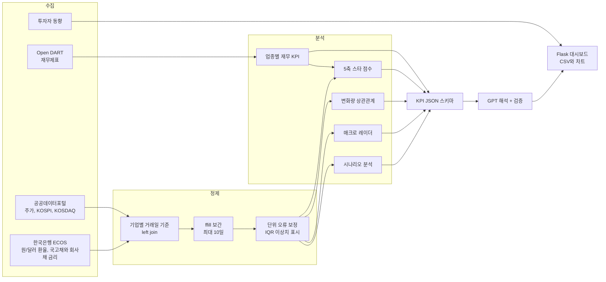

# 📈 FINANCIAL LAB

기업명만 입력하면 재무제표, 주가, 환율과 금리를 거래일 기준으로 묶어 분석하는 기업 재무 및 매크로 분석 서비스

**문제** 재무제표만으로는 환율과 금리에 따른 주가의 시장 대비 변동을 파악하기 어렵습니다.<br>
**해결** 4개 출처 데이터를 거래일 기준으로 결합해 KPI, 매크로 레이더와 복합 시나리오를 자동 계산합니다.<br>


---

## 📋 프로젝트 개요

| 항목 | 내용 |
|------|------|
| **개발 기간** | 2026.10 |
| **프로젝트 유형** | 개인 프로젝트 |
| **핵심 기술** | Python, Pandas, Matplotlib, Flask, Pydantic, OpenAI API |
| **데이터&nbsp;출처** | [Open DART](https://opendart.fss.or.kr/)(재무제표), [공공데이터포털](https://www.data.go.kr/)(주가, KOSPI, KOSDAQ)<br>[한국은행 ECOS](https://ecos.bok.or.kr/api/)(환율, 국고채와 회사채 금리), 네이버 증권 비공식 응답(투자자 동향) |
| **배포 링크** | [바로가기](https://financial-analysis-2026.vercel.app/) |

이 프로젝트는 다음 세 질문에 답합니다.

| 분석 질문 | 사용한 분석 |
|---|---|
| 기업 주가는 환율, 금리, 신용 스프레드와 같은 방향으로 움직였는가? | 일별 변화량 Pearson 상관관계 |
| 그 움직임은 시장 전체 효과인가, 이 기업만의 특성인가? | 시장 상관을 뺀 **매크로 레이더**와 이동상관 안정성 |
| 금리 상승과 원화 약세가 함께 온 날, 기업은 시장보다 버텼는가? | 조건부 **시나리오 분석** |

## 🎬 시연


**1개 기업 분석**: 삼성전자, 재무제표 3년, 주가 1년<br>
기업명 오타를 입력하면 비슷한 후보를 안내하고 분석을 막는 장면을 포함합니다.


**2개 이상 기업 비교**: 삼성전자, SK하이닉스와 현대자동차, 재무제표 3년, 주가 1년<br>
약칭 현대차를 입력하면 현대자동차로 분석하고, 입력과 다른 기업명으로 분석했다는 안내를 표시합니다.

결과 화면은 재무, 주가, 매크로 및 요약 탭으로 구성됩니다.<br>
요약 탭은 5축 스타차트, GPT 분석 및 CSV 다운로드를 제공합니다.

## 🔍 분석 사례

시연과 같은 조건(재무제표 3년, 주가 1년, 기준일 2026-10-14)으로 실행한 결과입니다.

### 1. 상관이 높아 보여도 시장 효과일 수 있다: 삼성전자

삼성전자와 금리, KOSPI와 금리의 상관은 모두 **-0.34**입니다. 매크로 레이더 판정은 모두 **노출 약**입니다.

→ 금리 반응은 삼성전자 고유 특성이 아닌 **시장 전체의 움직임**이었습니다.

→ 원화 약세와 금리 상승이 겹친 **19일**에는 삼성전자가 KOSPI보다 **0.61%p 더 하락해 시장보다 약했습니다.**

### 2. 같은 성장률 배지도 내용이 다르다: 삼성전자, SK하이닉스, 현대자동차

| 지표 (최근 연도, 3년 추세) | SK하이닉스 | 삼성전자 | 현대자동차 |
|---|---|---|---|
| 매출 성장률 | 46.76% `개선, 둔화` | 10.88% `개선, 둔화` | 6.29% `개선, 둔화` |
| 영업이익 성장률 | 101.16% `개선` | 33.23% `개선, 둔화` | -19.47% `악화` |
| 영업이익률 | 48.59% `개선` | 13.07% `개선` | 6.16% `악화` |
| 부채비율 | 45.95% `개선` | 29.94% `악화` | 188.95% `악화` |
| 주가 1년 수익률 (KOSPI +68.7%) | +244.84% | +153.28% | +40.58% |
| 시나리오 19일, 시장 대비 차이 | -0.01%p `유사` | -0.61%p `더 하락` | -0.76%p `더 하락` |

- **세 기업 모두** 3년 연속 매출이 늘었지만 최근 성장률은 둔화했습니다.
- **SK하이닉스**는 영업이익이 적자에서 흑자로 전환돼 추세가 `개선`됐습니다.
- **현대자동차**는 영업이익 지표가 `악화`됐고, 1년 수익률도 KOSPI보다 낮았습니다.
- **시나리오**에서 삼성전자와 현대차는 시장보다 더 하락했고, SK하이닉스는 유사했습니다.

> 결과는 과거 동행성일 뿐 인과관계나 투자 근거가 아닙니다. 세 기업 모두 `노출 약`입니다.

## 🛠️ 기술 스택 및 선택 이유

| 기술 | 버전 | 선택 이유 |
|------|------|-----------|
| **Python** | 3.10+ | API 수집, 분석과 웹 서버를 한 언어로 구성<br>표준 `urllib`로 공공 API 3개와 비공식 공개 응답 1개를 호출해 별도 HTTP 의존성 없이 운영 |
| **Pandas** | 2.3.3 | `merge_asof`로 직전 관측값만 사용해 미래 값 혼입 방지<br>`groupby`, `shift`로 성장률과 평균자본, `rolling().corr()`로 이동상관 계산 |
| **NumPy** | 2.2.6 | `np.select`로 기업별 업종(일반, 금융, 보험)을 벡터 연산으로 판별<br>`np.polyfit`으로 환율 변화율과 금리 변화폭 산점도의 추세선 기울기 계산 |
| **Matplotlib** | 3.10.9 | 서버에서 Agg 백엔드로 PNG 차트를 생성해 CSV와 함께 파일로 제공<br>koreanize-matplotlib 0.1.1로 배포 환경의 한글 폰트 깨짐 방지 |
| **Flask** | 3.1.3 | 분석 파이프라인을 그대로 호출하는 가벼운 웹 서버<br>진행률 조회와 백그라운드 GPT 분석 상태 조회 엔드포인트 구성 |
| **Pydantic** | 2.13.5 | GPT 응답 스키마를 정의해 섹션별 문장과 근거 KPI 키를 구조화 출력으로 강제<br>스키마를 벗어난 응답은 파싱 단계에서 차단 |
| **OpenAI API** | 2.54.0 | Responses API로 Python이 계산한 KPI JSON만 해석<br>`store=False`로 응답 저장 비활성화, 실패 시 KPI 기반 대체 인사이트로 전환 |
| **Pillow** | 12.3.0 | 서버리스 환경에서 차트를 WebP로 압축해 HTML에 직접 삽입<br>임시 파일이 사라져도 결과 화면의 차트 유지 |
| **Vercel** | - | Flask 앱을 서버리스 함수로 배포해 별도 서버 없이 공개<br>`maxDuration` 300초로 장시간 요청을 처리하고 서울(`icn1`) 리전에서 실행 |


## ✨ 핵심 성과

- **4개 출처 데이터 통합**: DART, 공공데이터포털, ECOS 및 투자자 동향을 거래일 기준으로 결합<br>분석 시간은 1개 기업 약 12초, 3개 기업 약 35초이며 GPT는 별도 생성
- **업종별 KPI 설계**: 일반, 금융 및 보험업에 맞춰 KPI를 계산하고 산출 불가 사유를 기록
- **고정 기준 5축 스타 점수**: 최신 KPI와 3개년 추세를 5개 축으로 평가해 0점에서 100점까지 산출
- **데이터 품질 관리**: 결측 보간, 소수점 및 단위 오류 보정과 IQR 이상치 표시 내역을 `data_quality_log.csv`로 추적
- **검증된 LLM 해석**: 근거 KPI, 숫자 및 금지 표현을 검증하고 실패 시 대체 인사이트 제공
- **재현 가능성**: 외부 API를 가짜 응답으로 대체한 테스트 207개, 고정 버전 `requirements.lock`

## 🔄 분석 파이프라인



## 🔬 분석 설계와 의사결정

### 1. 수준값이 아닌 일별 변화량으로 상관을 계산

추세 시계열의 가짜 상관을 피하기 위해 환율과 금리는 수준값 대신 일별 변화량으로 분석합니다.

```text
주가와 시장지수  = 일간 수익률(%)
원/달러 환율     = 일간 변화율(%)
금리             = 일간 변화폭(bp)
신용 스프레드    = 일간 변화폭(bp)   # 회사채 3년 AA- − 국고채 3년
```

금리는 변화폭(bp)을 쓰며 관측값 10개 이상에서 계산합니다. **|r|** 기준은 0.3 미만 약함, 0.7 미만 중간, 0.7 이상 강함입니다.

### 2. 시장 효과를 분리하는 매크로 레이더

대부분의 종목은 시장지수와 함께 움직이므로, 기업-환율 상관이 높아도 시장 전체의 성질일 수 있습니다. 소속 시장지수(KOSPI 또는 KOSDAQ)의 상관을 빼서 기업 고유의 노출만 남깁니다.

```text
시장 대비 차이 = corr(기업 수익률, 외부 요인 변화) − corr(소속 시장지수 수익률, 외부 요인 변화)
```

시장 대비 차이 절댓값은 0.15 미만이면 약, 0.30 이상이면 강입니다. 유지율 80% 이상 및 전환율 5% 이하는 안정입니다.

### 3. 평균이 아닌 특정 환경의 실제 성과를 보는 시나리오 분석

환율 `+0.3%` 및 금리 `+3bp` 이상인 날의 기업과 시장 평균 수익률을 비교합니다.

```text
시장 대비 평균 차이 = 기업 평균 수익률 − 소속 시장지수 평균 수익률
```

조건 충족일이 없으면 `0일`만 표시하고 수익률과 판정은 비웁니다. 표본 10일 미만은 부족 경고를 표시합니다.

### 4. 업종별 KPI와 계산할 수 없는 값의 처리

| 구분 | 대표 KPI |
|---|---|
| 일반기업 | 매출 성장률, 영업이익률, ROE, 부채비율 |
| 금융업 | 순이자손익, 순수수료손익, ROE, ROA |
| 보험업 | 보험서비스수익 성장률, 보험서비스마진, ROE, 투자손익 |

은행과 보험사는 전용 KPI를 적용하고 자본 0 이하는 `자본잠식`으로 표시합니다. 세부 기준은 [분석 방법론](docs/analysis-methodology.md)에 정리했습니다.

## 🧹 데이터 품질 관리

| 문제 | 처리 |
|---|---|
| 휴장일이나 미고시로 외부 요인 값이 없는 거래일 | 직전 값으로 채움(ffill), 10일 넘는 공백은 결측 유지 |
| 보간된 날의 변화량 0 | 상관이 왜곡되지 않도록 **상관 계산과 이상치 판정에서 제외** |
| 10배 이상 튄 뒤 복귀하는 값 | 단위 오류로 보고 시가, 고가 및 저가와 함께 보정 |
| 하루 변화량이 IQR 범위 밖 | 삭제하지 않고 `원인 확인 필요`로만 표시 (실제 사건일 수 있음) |

모든 처리는 원래 값, 처리 값과 사유와 함께 `data_quality_log.csv`에 기록됩니다.

## 🤖 LLM 활용 방식

GPT는 데이터를 새로 계산하거나 수집하지 않고, **Python과 Pandas가 계산한 KPI JSON만 해석**합니다.

1. 구조화 출력(Pydantic 스키마)으로 성장성, 수익성, 안정성, 시장, 시나리오 섹션별 문장과 근거 KPI 키를 받습니다.
2. 근거 키가 실제 KPI에 있는지, 문장 속 숫자가 입력값과 일치하는지, 투자 권유 표현이 없는지 검증합니다.
3. 검증에 실패한 문장은 KPI 기반 문장으로 교체하고, API 오류가 나면 KPI 기반 대체 인사이트를 표시합니다.
4. 화면에서는 GPT가 쓴 숫자 대신 **근거 키에 해당하는 실제 KPI 값**을 Python이 채워 넣습니다.

GPT 분석은 백그라운드에서 생성하며 15분 유효 서명 요청만 허용하고 응답은 저장하지 않습니다.

## 🔧 트러블슈팅

| 문제 | 원인 | 해결 |
|---|---|---|
| 다중 기업 분석에 가짜 연도 행 생성 | `pivot_table`이 미수집 조합까지 생성 | 실제 수집 조합에 다시 결합 |
| 금융 및 보험사 3년 추세 누락 | DART 과거연도 단독 응답 누락 | 최신 보고서 비교금액으로 복원 |
| 1개월 조회에서 장기 지표 계산 불가 | 계산에 최대 40거래일 필요 | 계산용 시세만 70일 추가 수집 |
| Vercel에서 GPT 상태 및 차트 유실 | 요청 간 메모리와 파일 미공유 | 차트 삽입 및 KPI 재전송 방식 사용 |
| 배포 환경의 재무 수집 지연 | 함수가 미국(`iad1`)에서 실행 | 서울 리전(`icn1`) 지정 |
| 장기 환율 조회 지연 | 날짜별 API 호출 | ECOS 기간 조회로 1,000행씩 수집 |
| 오타 및 유사 법인명 오선택 | 유사도 기반 자동 선택 | 정확한 이름만 선택하고 후보 제시 |
| `현대차`가 현대차증권으로 선택 | 약칭과 법인명 부분 일치 | 약칭 매핑 및 결과 경고 |
| 투자자 동향 조회 실패 | 비공식 응답 형식 변경 | 경고 후 나머지 분석 계속 |

API 키 누락, 서비스 미승인과 호출 한도 오류의 조치는 [기술 및 운영 가이드의 문제 해결](docs/technical-guide.md#8-문제-해결)에서 확인할 수 있습니다.

## 🚀 빠른 시작

```bash
git clone https://github.com/David9733/financial_analysis.git
cd financial_analysis
cp .env.example .env        # Windows PowerShell: Copy-Item .env.example .env
```

`.env`에는 `DART_KEY`가 필수이며 다른 키는 선택입니다. 설정은 [기술 및 운영 가이드](docs/technical-guide.md#1-api-키)를 참고하세요.

```bash
uv run --python 3.10 --isolated --with-requirements requirements.lock src/app.py   
python -m unittest discover -s tests                                                
```

`uv` 없이 설치하는 방법과 CLI 사용법은 [기술 및 운영 가이드](docs/technical-guide.md#2-실행)에 있습니다.

## ⚠️ 한계와 향후 개선

**해석 시 한계**

- 상관관계는 인과관계가 아니며, 매크로 레이더는 실제 영업 노출액이나 미래 주가를 의미하지 않습니다.
- 업종지수를 사용하지 않아 시장 효과와 업종 효과를 완전히 분리하지 못합니다.
- 신용 스프레드는 시장 전체 지표이며 개별 기업의 실제 조달금리가 아닙니다.
- 짧은 조회기간은 관측 수가 적어 일부 날짜에 민감합니다.
- 유의성 검정과 신뢰구간이 없어 작은 상관 및 수익률 차이는 우연일 수 있습니다.
- 노출 강도와 안정성은 경험적 기준이며, 설정 이유는 [분석 방법론](docs/analysis-methodology.md#8-판정-기준값을-정한-방식)에 있습니다.
- 스타 점수는 현재 KPI를 고정 기준으로 요약한 참고값이며 투자등급, 기업가치 평가나 미래 주가 예측이 아닙니다.
- 결과는 공개 데이터 탐색용이며 투자, 매수 또는 매도 권고가 아닙니다.

**향후 개선**

- 업종지수를 추가해 시장, 업종과 기업 고유 효과를 단계적으로 분리
- 상관 차이 대신 다중 회귀 기반 베타로 외부 요인 민감도 추정
- 상관계수와 시나리오 수익률 차이에 부트스트랩 신뢰구간 적용
- 공개 배포 사이트에 요청 제한과 사용자 인증 추가

## 📚 문서

- [분석 방법론](docs/analysis-methodology.md): 지표 계산식, 3년 추세와 스타 점수 기준, 결측 처리, 이상치와 상관분석 기준
- [기술 및 운영 가이드](docs/technical-guide.md): API 키와 실행, Vercel 배포, 출력 구조, 소스 구조, 문제 해결과 보안
