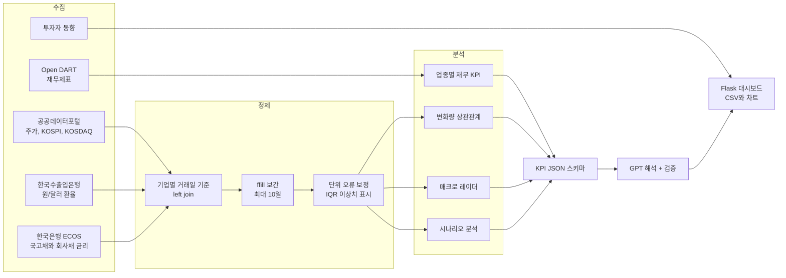

# 📈 FINANCIAL LAB

> 기업의 재무 성과와 주가가 시장지수, 환율, 금리 및 신용 스프레드와 어떻게 움직였는지 일별 데이터로 분석합니다.


기업명을 입력하면 재무제표와 일별 시장 데이터를 수집하고, 업종별 KPI, 주가 흐름, 투자자 거래량, 상관관계와 매크로 레이더를 한 화면에 보여 줍니다. 한 기업을 넣으면 상세 분석, 두 기업 이상을 넣으면 비교 분석으로 표시합니다.

**목차**: [배경](#-프로젝트-배경) | [핵심 성과](#-핵심-성과) | [파이프라인](#-분석-파이프라인) | [분석 설계](#-분석-설계와-의사결정) | [데이터 품질](#-데이터-품질-관리) | [LLM 활용](#-llm-활용-방식) | [트러블슈팅](#️-트러블슈팅) | [빠른 시작](#-빠른-시작) | [한계](#️-한계와-향후-개선)

## 🎬 시연

https://github.com/user-attachments/assets/fd538833-aba5-4605-85de-0af79b1dd0b6

## 🎯 프로젝트 배경

재무제표로는 기업이 얼마나 벌었는지 알 수 있습니다. 하지만 **환율이 오르거나 금리가 뛸 때 이 기업 주가가 시장보다 더 흔들리는지**는 알 수 없습니다. 이를 확인하려면 DART, 주가, 환율과 금리 데이터를 각각 내려받아 날짜를 맞춰야 하고, 그 과정에서 휴장일, 결측과 단위 오류를 직접 처리해야 합니다.

이 프로젝트는 그 과정을 자동화해 다음 세 질문에 답합니다.

| 분석 질문 | 사용한 분석 |
|---|---|
| 평소 이 기업 주가는 환율, 금리, 신용 스프레드와 같은 방향으로 움직였는가? | 일별 변화량 Pearson 상관관계 |
| 그 움직임은 시장 전체 효과인가, 이 기업만의 특성인가? | 시장 상관을 뺀 **매크로 레이더**와 이동상관 안정성 |
| 금리 상승과 원화 약세가 함께 온 날, 기업은 시장보다 버텼는가? | 조건부 **시나리오 분석** |

## ✨ 핵심 성과

- **5개 출처 데이터 통합**: Open DART, 공공데이터포털(주가, 지수), 한국수출입은행, 한국은행 ECOS와 투자자 동향 데이터를 거래일 기준 하나의 테이블로 병합
- **업종별 KPI 설계**: 일반기업, 금융업, 보험업의 계정 구조 차이를 반영해 KPI를 따로 계산하고, 계산할 수 없는 값은 추정하지 않고 사유를 기록
- **데이터 품질 관리**: 결측 보간, 소수점 및 단위 오류 보정과 IQR 이상치 표시 내역을 `data_quality_log.csv`로 추적
- **검증된 LLM 해석**: GPT가 쓴 문장의 근거 KPI, 숫자와 금지 표현을 Python으로 검증하고 실패 시 KPI 기반 대체 인사이트 제공
- **재현 가능성**: 외부 API를 가짜 응답으로 대체한 테스트 152개, 고정 버전 `requirements.lock`

## 🔄 분석 파이프라인



## 🔬 분석 설계와 의사결정

### 1. 수준값이 아닌 일별 변화량으로 상관을 계산

환율과 금리처럼 추세가 있는 시계열은 서로 관계가 없어도 수준값 상관이 높게 나옵니다. 이런 가짜 상관을 피하기 위해 분석에는 변화량을 사용합니다.

```text
주가와 시장지수  = 일간 수익률(%)
원/달러 환율     = 일간 변화율(%)
금리             = 일간 변화폭(bp)
신용 스프레드    = 일간 변화폭(bp)   # 회사채 3년 AA- − 국고채 3년
```

금리는 이미 백분율이므로 변화율이 아닌 변화폭(bp)을 사용합니다. 유효 관측값이 10개 이상일 때만 상관을 계산하며, `|r| < 0.3` 약함, `0.3 ≤ |r| < 0.7` 중간, `|r| ≥ 0.7` 강함으로 해석합니다.

### 2. 시장 효과를 분리하는 매크로 레이더

대부분의 종목은 시장지수와 함께 움직이므로, 기업-환율 상관이 높아도 시장 전체의 성질일 수 있습니다. 소속 시장지수(KOSPI 또는 KOSDAQ)의 상관을 빼서 기업 고유의 노출만 남깁니다.

```text
시장 대비 차이 = corr(기업 수익률, 외부 요인 변화) − corr(소속 시장지수 수익률, 외부 요인 변화)
```

| 판정 | 기준 |
|---|---|
| 노출 약 / 중 / 강 | 시장 대비 차이 절댓값 `< 0.15` / `0.15 ~ 0.30` / `≥ 0.30` |
| 안정 | 이동상관 부호 유지율 80% 이상 및 부호 전환율 5% 이하 |

이동상관 창은 1개월 10일, 3개월 20일, 6개월 이상 60거래일입니다. 전체기간 상관이 `-0.1 ~ +0.1`이면 `방향성 없음`으로 표시하고, 1개월과 3개월 결과는 단기 참고값으로 구분합니다.

### 3. 평균이 아닌 특정 환경의 실제 성과를 보는 시나리오 분석

상관은 평균적인 관계일 뿐이므로, 원/달러 환율 `+0.3%` 이상 **그리고** 국고채 3년 `+3bp` 이상인 거래일만 골라 기업과 시장의 평균 수익률을 비교합니다.

```text
시장 대비 평균 차이 = 기업 평균 수익률 − 소속 시장지수 평균 수익률
```

조건을 만족한 날이 없으면 결과를 억지로 만들려고 **기준을 낮추지 않고** `비교기간 없음`으로 표시합니다. 표본이 1일에서 4일이면 `표본 매우 적음`, 5일에서 9일이면 `제한적 표본`으로 함께 표시합니다.

### 4. 업종별 KPI

| 구분 | 대표 KPI |
|---|---|
| 일반기업 | 매출 성장률, 영업이익률, ROE, 부채비율 |
| 금융업 | 순이자손익, 순수수료손익, ROE, ROA |
| 보험업 | 보험서비스수익 성장률, 보험서비스마진, ROE, 투자손익 |

은행과 보험사에는 일반적인 의미의 매출이 없어 일반기업 KPI를 그대로 적용하면 왜곡됩니다. 그래서 업종을 판별해 KPI 세트를 바꿉니다. 연결재무제표를 우선하고, 원천 계정이나 비교연도가 없으면 `비교연도 없음`처럼 사유를 남깁니다.

상세 계산식은 [분석 방법론](docs/analysis-methodology.md)에 정리했습니다.

## 🧹 데이터 품질 관리

| 문제 | 처리 |
|---|---|
| 휴장일이나 미고시로 외부 요인 값이 없는 거래일 | 직전 값으로 채움(ffill), 첫 구간은 조회 시작 전 10일 자료 사용 |
| 10일 넘게 관측값이 없는 공백 | 오래된 값으로 채우지 않고 결측 유지 |
| 보간된 날의 변화량 0 | 상관이 왜곡되지 않도록 **상관 계산과 이상치 판정에서 제외** |
| 앞뒤 값 대비 10배, 100배, 1000배 튀었다 복귀하는 값 | 소수점이나 단위 오류로 보고 보정, 같은 날 시가, 고가, 저가도 함께 보정 |
| 하루 변화량이 IQR 범위 밖 | 삭제하지 않고 `원인 확인 필요`로만 표시 (실제 사건일 수 있음) |

모든 처리는 원래 값, 처리 값과 사유와 함께 `data_quality_log.csv`에 기록됩니다.

## 🤖 LLM 활용 방식

GPT는 데이터를 새로 계산하거나 수집하지 않고, **Python과 Pandas가 계산한 KPI JSON만 해석**합니다.

1. 구조화 출력(Pydantic 스키마)으로 성장성, 수익성, 안정성, 시장, 시나리오 섹션별 문장과 근거 KPI 키를 받습니다.
2. 근거 키가 실제 KPI에 있는지, 문장 속 숫자가 입력값과 일치하는지, 투자 권유 표현이 없는지 검증합니다.
3. 검증에 실패하면 실패 사유를 담아 다시 요청합니다(첫 요청 포함 최대 3번). API 오류가 나거나 끝내 검증을 통과하지 못하면 KPI 기반 대체 인사이트를 표시합니다.
4. 화면에서는 GPT가 쓴 숫자 대신 **근거 키에 해당하는 실제 KPI 값**을 Python이 채워 넣습니다.

응답 저장은 `store=False`로 비활성화하며, API 키가 없어도 재무 및 시장 분석은 모두 이용할 수 있습니다.

## 🛠️ 트러블슈팅

| 문제 | 해결 |
|---|---|
| 수출입은행 환율 API는 날짜 1개당 1회 호출이고 일일 한도가 1,000건이라 3년 조회에 약 780건이 필요 | 주말은 호출하지 않고, 확정된 과거 환율은 디스크에 캐시하며, 4개 스레드로 병렬 호출. 인증 및 한도 오류는 즉시 중단 |
| 사용자가 `에스케이하이닉스`, `엘지전자`처럼 한글로 입력하면 DART 기업명과 일치하지 않음 | 한글 브랜드 별칭 정규화 → 부분 일치 → 유사도 순으로 검색하고 상장사와 최근 갱신 법인을 우선 선택, 모호하면 후보 목록 안내 |
| 투자자 동향은 공식 API가 없어 응답 형식 변경 시 실패 가능 | 별도 예외로 분리해 실패해도 나머지 분석은 계속 진행하고 경고만 표시 |

## 🖥️ 화면 구성

결과 화면 상단에는 KOSPI, KOSDAQ, 원/달러 환율과 금리의 최신값 및 기업 스냅샷을 표시합니다.

| 탭 | 내용 |
|---|---|
| 재무 | 전체 재무 KPI, 최근 3개년 추세 배지와 연도별 재무 차트 |
| 주가 | 주가 KPI, 정규화 주가 비교, 이동평균, 볼린저 밴드, 거래량과 투자자 비중 |
| 매크로 | 시장 및 외부 요인, 매크로 레이더, 시나리오 분석과 상관관계 차트 |
| 요약 | GPT 기업 분석, 기업 간 KPI 비교, 데이터 미리보기와 CSV 다운로드 |

다중 기업에서는 지표를 행, 기업을 열로 둔 비교표와 첫 공통 거래일을 100으로 맞춘 주가 비교 차트를 제공합니다.

## 🗂️ 데이터 출처

| 영역 | 데이터 | 출처 |
|---|---|---|
| 재무 | 기업 정보와 연간 재무제표 | [Open DART](https://opendart.fss.or.kr/) |
| 주가 및 시장 | 일별 OHLC, 거래량, 시가총액, KOSPI와 KOSDAQ 종가 | [공공데이터포털](https://www.data.go.kr/) 금융위원회 |
| 환율 | 원/달러 매매기준율 | [한국수출입은행](https://www.koreaexim.go.kr/) |
| 금리 | 국고채 3년과 회사채 3년 AA- | [한국은행 ECOS](https://ecos.bok.or.kr/api/) |
| 투자자 | 최근 거래일의 기관, 개인, 외국인과 기타 매수 및 매도 거래량 | 네이버 모바일 증권 비공식 공개 응답 |

## 🚀 빠른 시작

### 1. API 키 준비

```bash
git clone https://github.com/David9733/financial_analysis.git
cd financial_analysis
cp .env.example .env        # Windows PowerShell: Copy-Item .env.example .env
```

| 환경 변수 | 필수 여부 | 없을 때 |
|---|---|---|
| `DART_KEY` | **필수** | 분석 불가 |
| `PUBLIC_STOCK_API_KEY` | 선택 | 주가와 시장지수 분석 생략 |
| `KOREAEXIM_API_KEY` | 선택 | 환율 지표 제외 |
| `ECOS_API_KEY` | 선택 | 금리와 신용 스프레드 지표 제외 |
| `OPENAI_API_KEY` | 선택 | KPI 기반 대체 인사이트 표시 |
| `OPENAI_MODEL` | 선택 | 기본값 `gpt-4o-mini` |

### 2. 설치와 실행

Python 3.10 이상을 사용합니다.

```bash
python -m venv .venv
# Windows
.\.venv\Scripts\python.exe -m pip install -r requirements.lock
.\.venv\Scripts\python.exe src/app.py
# macOS / Linux
.venv/bin/python -m pip install -r requirements.lock
.venv/bin/python src/app.py
```

브라우저에서 `http://127.0.0.1:5000`을 엽니다. `uv`를 사용한다면 한 줄로 실행할 수 있습니다.

```bash
uv run --python 3.10 --isolated --with-requirements requirements.lock src/app.py
```

### 3. 테스트

```bash
python -m unittest discover -s tests
```

테스트 152개는 외부 API를 가짜 응답으로 대체하므로 네트워크와 API 키 없이 실행됩니다.

## 📤 생성 결과

웹 결과는 `output/web_runs/<실행 ID>/`, CLI 결과는 `output/cli/`에 저장됩니다.

| 결과물 | 내용 |
|---|---|
| `financial_analysis.csv` | 업종별 연간 재무지표 |
| `stock_prices.csv`, `stock_summary.csv` | 일별 주가와 기간 요약 |
| `investor_summary.csv` | 투자자별 매수, 매도, 순매수 거래량과 비중 |
| `market_macro.csv` | 주가, 시장지수와 외부 요인의 수준값 및 변화량 |
| `data_quality_log.csv` | 보간, 단위 보정과 이상치 처리 내역 |
| `kpi_analysis.json` | 화면과 GPT 분석에 사용하는 KPI 스키마 |
| `gpt_insights.json` | GPT 또는 KPI 기반 대체 인사이트와 다중 기업 비교 |
| `charts/`, `stock_charts/` | 재무, 주가, 투자자와 매크로 차트 |

데이터가 없는 결과물은 생성되지 않을 수 있으며, 완료된 웹 결과는 1시간 보관 후 정리됩니다.

## 🧱 주요 소스

| 영역 | 파일 | 역할 |
|---|---|---|
| 수집 | `dart_api.py` | DART 기업 검색, 기업코드 캐시와 재무제표 조회 |
| | `stock_api.py` | 주가, KOSPI와 KOSDAQ 지수 조회 |
| | `macro_api.py` | 환율(캐시, 병렬 호출)과 ECOS 금리 조회 |
| | `investor_analysis.py` | 투자자별 거래량 집계 |
| 정제 | `macro_analysis.py` | 거래일 병합, 변화량, 보간과 이상치 |
| | `data_quality.py` | 단위 오류 보정과 품질 로그 |
| | `stock_analysis.py` | 주가 정제, 이동평균과 볼린저 밴드 |
| 분석 | `financial_analysis.py` | 계정 매칭, 업종 판별과 재무 KPI |
| | `kpi_analysis.py` | KPI 스키마, 매크로 레이더와 시나리오 |
| | `correlation_insight.py` | 기업별 시장 및 외부 요인 동행성 해석 |
| | `gpt_analysis.py`, `analysis_prompt.py` | GPT 구조화 출력, 근거 검증과 대체 인사이트 |
| 출력 | `visualization.py`, `stock_visualization.py` | 재무, 주가, 투자자와 매크로 차트 |
| | `main.py`, `app.py` | 통합 파이프라인과 Flask 대시보드 |

## ⚠️ 한계와 향후 개선

**해석 시 한계**

- 상관관계는 인과관계가 아니며, 매크로 레이더는 실제 영업 노출액이나 미래 주가를 의미하지 않습니다.
- 업종지수를 사용하지 않아 시장 효과와 업종 효과를 완전히 분리하지 못합니다.
- 신용 스프레드는 시장 전체 지표이며 개별 기업의 실제 조달금리가 아닙니다.
- 짧은 조회기간은 관측 수가 적어 일부 날짜에 민감합니다.
- 결과는 공개 데이터 탐색용이며 투자, 매수 또는 매도 권고가 아닙니다.

**향후 개선**

- 업종지수를 추가해 시장, 업종과 기업 고유 효과를 단계적으로 분리
- 상관 차이 대신 다중 회귀 기반 베타로 외부 요인 민감도 추정
- 사용자 인증, 요청 제한과 운영용 WSGI 서버를 갖춘 공개 배포

## 📚 문서와 기술 스택

- [분석 방법론](docs/analysis-methodology.md): 지표 계산식, 결측 처리, 이상치와 상관분석 기준
- [기술 및 운영 가이드](docs/technical-guide.md): API별 처리, CLI 사용법, 출력 구조와 보안

`Python`, `Pandas`, `Matplotlib`, `koreanize-matplotlib`, `Flask`, `Pydantic`, `OpenAI API`
